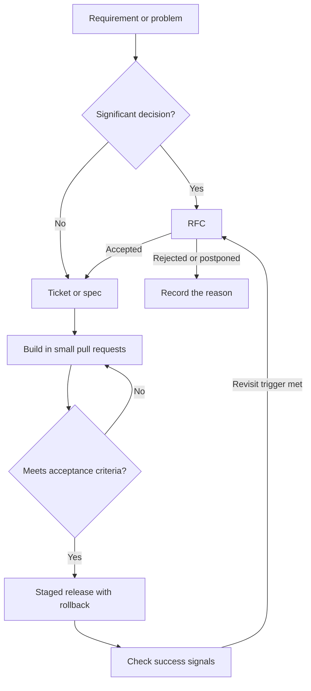

# How we build

How technical direction moves from a need to a released change at the fictional Example Lab.

"Significant" is defined in [When to write one](../README.md#when-to-write-one).

| Stage | Output | Accountable | Ready to move on when |
| --- | --- | --- | --- |
| Requirement | Problem, users, constraints | Requesting team with an engineering lead | The problem can be stated without naming a solution |
| RFC | Decision and trade-offs | Named decider | Blocking comments are resolved or recorded as dissent |
| Spec | Scope, interfaces, work packages, acceptance criteria | Delivery owner | The implementer can explain how each criterion will be tested |
| Build and review | Code, tests, evidence | Implementer, reviewers | Every criterion passes |
| Release | Version, rollout, rollback path, runbook | Delivery owner | Someone other than the author can operate and roll back |
| Follow-up | Signals compared with targets | Decider | Keep, adjust or revisit is recorded |

## The principal engineer's part

- Get the problem and criteria agreed before debating tools.
- Decide what is theirs to decide, delegate the rest, and explain either way.
- Review where mistakes are costly: interfaces, data, failure and rollback.
- Grow others as authors, reviewers and deciders.
- Return to the success signals, and say so when a decision was wrong.

## Handing work to engineers and contractors

The spec is the shared agreement on what "done" means.

1. **Before the start:** name one owner who accepts the work, and list what we provide.
2. **First days:** the implementer returns questions and assumptions. Answers go into the spec.
3. **During:** review small changes often. Demonstrate working software after each work package.
4. **Changes:** edit the spec by pull request, so scope never moves only in chat.
5. **Acceptance:** judge evidence against the criteria. New wishes become new work.
6. **Handover:** a staff member operates the result unaided before the engagement closes.

Fix outcomes, interfaces and constraints. Leave other implementation choices to the implementer.

If a document does not change a decision, guide the build or help a later reader, skip it.
